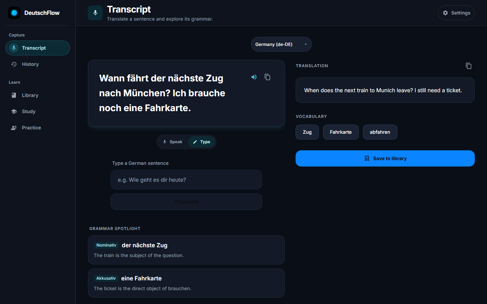
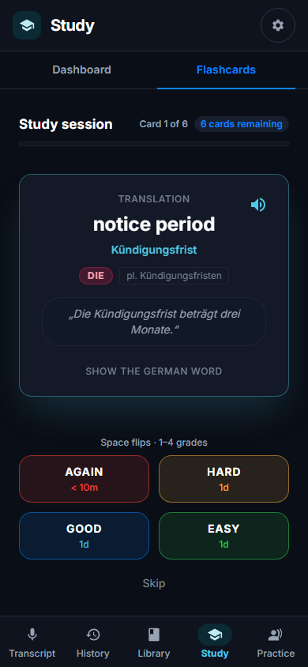
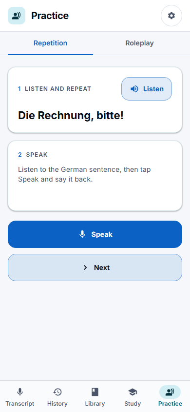
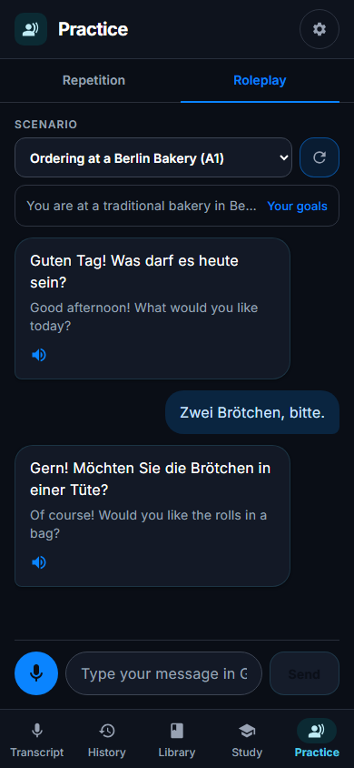
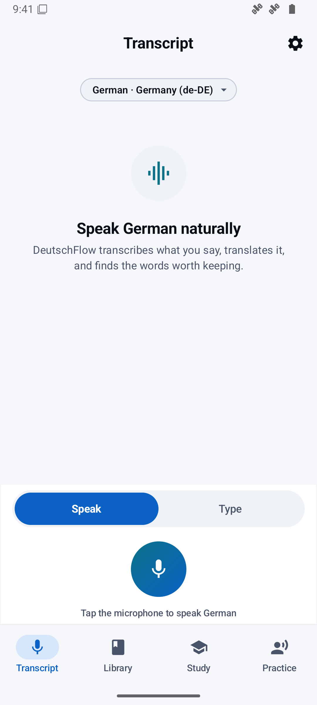
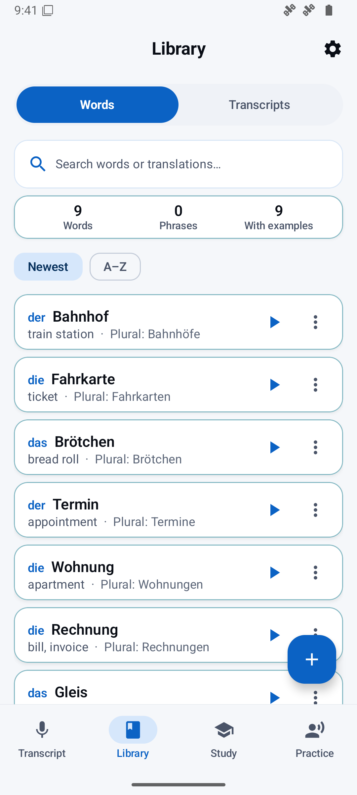
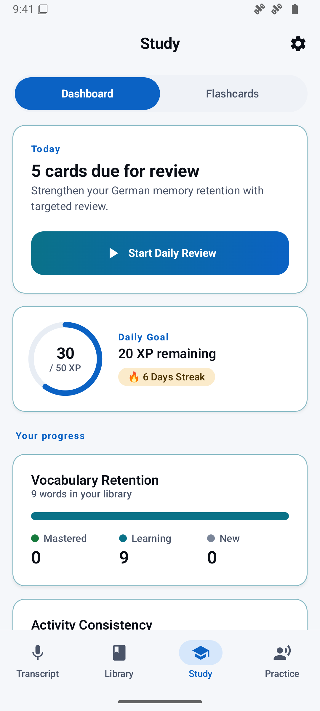

# DeutschFlow

DeutschFlow turns everyday German into study material. Speak or type a sentence, read its translation and grammar notes, then save useful words for spaced repetition. DeutschFlow is available as a native Android app and an installable web app.

[](https://github.com/shareef01/deutschflow/actions/workflows/build.yml)

[](LICENSE)



## What you can do

- **Translate** spoken or typed German and inspect grammar, vocabulary and examples in context.
- **Build a library** with articles, plurals, verb forms and example sentences. Search saved words and listen to them aloud.
- **Review flashcards** with SM-2 scheduling. Reveal the answer before grading and preview the interval for each grade.
- **Practise speaking** by listening and repeating, or try voice and text roleplay in situations such as ordering at a bakery. Repetition feedback reports how many words the recogniser heard.
- **Keep your progress** on your device and move it between Android and web with a plain JSON or passphrase-encrypted backup.

## Screenshots

### Web

<p>
  
  
  
</p>

[Browse all web captures](docs/screenshots/portfolio), including desktop and mobile views in both themes. The capture suite imports a synthetic backup and stubs Groq.

### Android

<p>
  
  
  
</p>

[Browse the Android gallery](docs/screenshots/android). The captures show DeutschFlow 1.1.0 on an API 36 emulator with a synthetic library.

## Getting started

Translation, AI-generated word details and roleplay use your Groq API key. Add it in **Settings** on Android or **Settings → AI & Translation** on the web.

### Web

Use Node.js 22.13+ on the 22.x line, or Node.js 24+.

```bash
cd web
npm ci
cp .env.example .env.local
```

Set `SITE_PASSWORD` and `SESSION_SECRET` in `.env.local`. On Windows PowerShell, use `Copy-Item .env.example .env.local` to create the file.

```bash
npm run dev
```

Open [localhost:3000](http://localhost:3000) and sign in with `SITE_PASSWORD`.

For Vercel, set the project root to `web` and configure the production access gate, including its shared HTTPS Redis store. See the [deployment and security guide](docs/SECURITY.md).

### Android

Use Android Studio with Android SDK Platform 37 and a JDK 21 Gradle toolchain. Run the `app` configuration on an Android 12 (API 31) or newer device or emulator, or build the APK from the repository root.

```bash
./gradlew assembleDebug
```

The APK is written to `app/build/outputs/apk/debug/app-debug.apk`. On Windows, run `.\gradlew.bat assembleDebug`.

## Data and privacy

Android stores learning data in Room and protects the Groq key with Android Keystore. The web app stores learning data in IndexedDB and encrypts the key using Web Crypto. Both clients send text to Groq for AI features. Android requests on-device speech recognition. Web speech recognition depends on the browser and may use its vendor's speech service. Typing is available on both platforms.

Backups include vocabulary, transcripts, review history, progress and roleplay messages. The clients share a [backup format](docs/BACKUP_FORMAT.md), and backups exclude API keys. Keep manual backups if you use the web app, since clearing site data removes its library. See the [security guide](docs/SECURITY.md) for details.

## Development

| Path | Contents |
| --- | --- |
| `app/` | Android client using Kotlin, Jetpack Compose, Room and Hilt |
| `web/` | Next.js PWA using React, TypeScript and Dexie |
| `tools/` | Repository audits for translations, palette parity and contrast |
| `docs/` | Design system, backup format, security guide and screenshots |

The clients use shared test fixtures for scheduling, text handling and backup compatibility. See the [engineering case study](docs/portfolio-case-study.md) and [design system](docs/DESIGN_SYSTEM.md).

### Checks and screenshot capture

Run Android checks and the repository audit from the root.

```bash
python tools/audit_repo.py
./gradlew testDebugUnitTest lintDebug
./gradlew connectedDebugAndroidTest
```

The connected tests require an API 31+ device or emulator. The [CI workflow](.github/workflows/build.yml) also builds the Android release and runs platform smoke tests on API 35 and 36.

Run web checks and screenshot capture from `web/`.

```bash
npm run lint
npm run typecheck
npm test
npx playwright install chromium firefox webkit
npm run test:e2e
npm run screenshots
```

`npm run screenshots` builds and serves the app locally and writes to `docs/screenshots/portfolio/`. Set `PORTFOLIO_OUT` to capture to a different directory. The [visual regression baselines](docs/screenshots/web) are used by the separate Playwright visual audit.

## License

[MIT](LICENSE)
