# DeutschFlow

**Speak or type German, understand it, and keep the words worth keeping.** A local-first German learning app with a native Android client and an installable web PWA.

[](https://github.com/shareef01/deutschflow/actions/workflows/build.yml)


[](LICENSE)

<p align="center">
  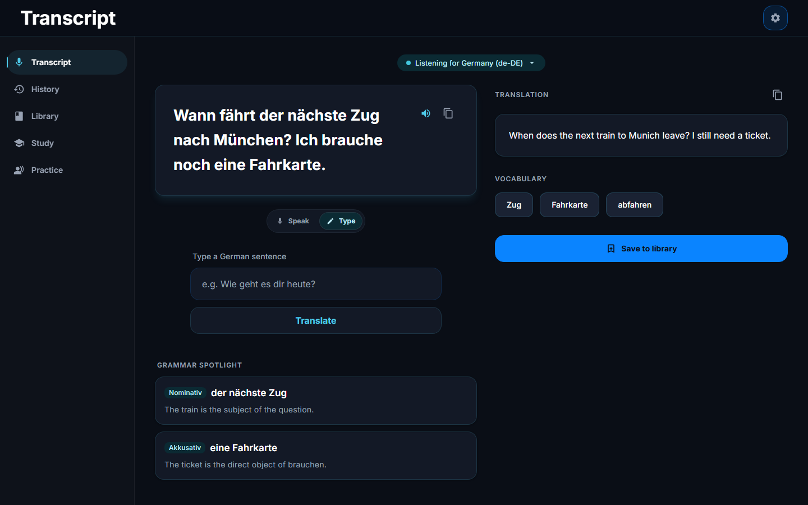
  &nbsp;
  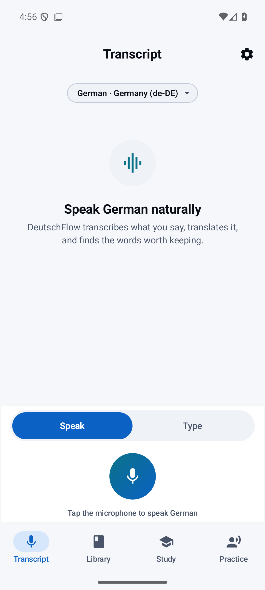
</p>

---

## The problem

Learners who live with German meet far more of it than a course gives them: on a menu, at a station, in a meeting. Most of it is forgotten by evening. DeutschFlow turns those moments into study material. Say or type the sentence, read what it means and why the grammar works, save the words that matter, and let spaced repetition bring them back before they fade.

It is deliberately **local-first**. The library, review history and streak live on the device. Translation uses the learner's own Groq API key, and the app collects nothing.

## The learning loop

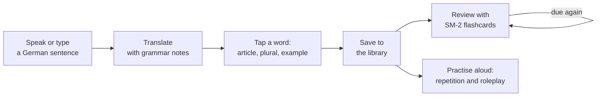

## A walkthrough

The web screenshots are produced by [`npm run screenshots`](web/tests/portfolio/capture.portfolio.ts) against the production build. It uses a synthetic library, restored through the app's own backup import, and a stubbed AI reply. No real learner data or API key is involved. Every screen is captured in dark and light themes, on a phone and on a desktop, in [`docs/screenshots/portfolio/`](docs/screenshots/portfolio/).

| | |
| :-- | :-- |
| 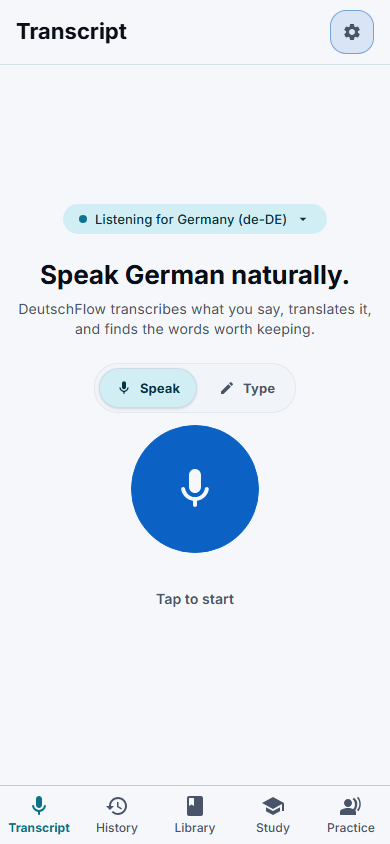 | **1. Transcript.** One unmistakable action, the microphone. Typing is one press away and feeds the same pipeline, and the recognition dialect is a tap on the chip above. |
| 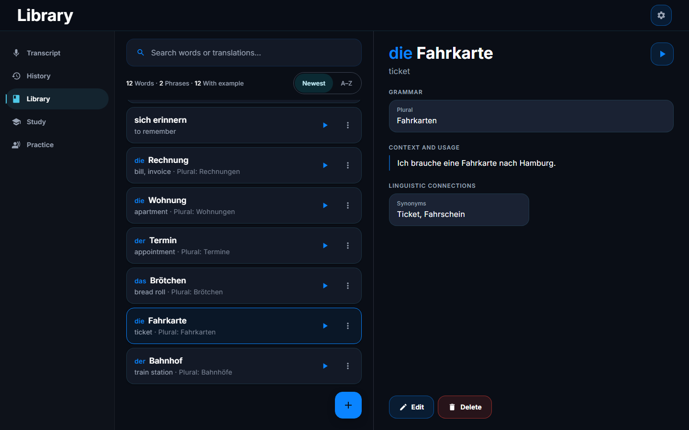 | **2. Library.** The German word leads, with its article as quiet grammar beside it and the meaning underneath. Details show the plural, verb forms, an example in context and any saved synonyms, and say so plainly when there are none. |
| 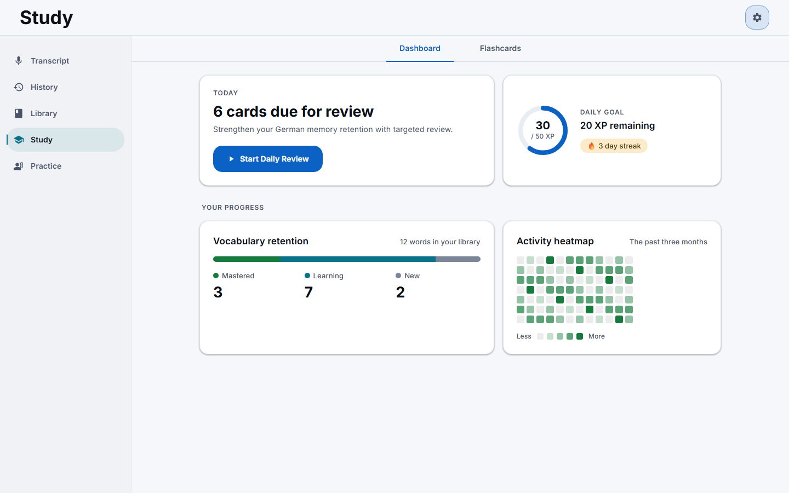 | **3. Study dashboard.** First what to do today (cards due, one click from a review), then how today is going, then how the library is doing over time. Every figure comes from stored data. |
| 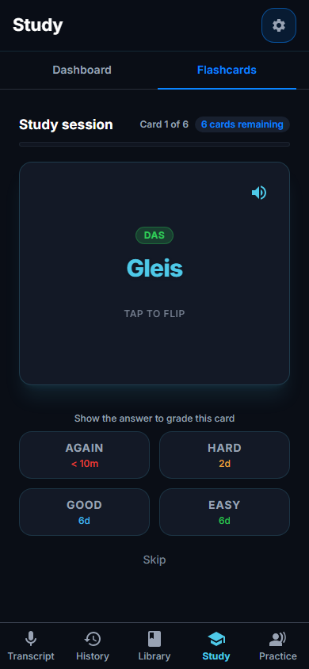 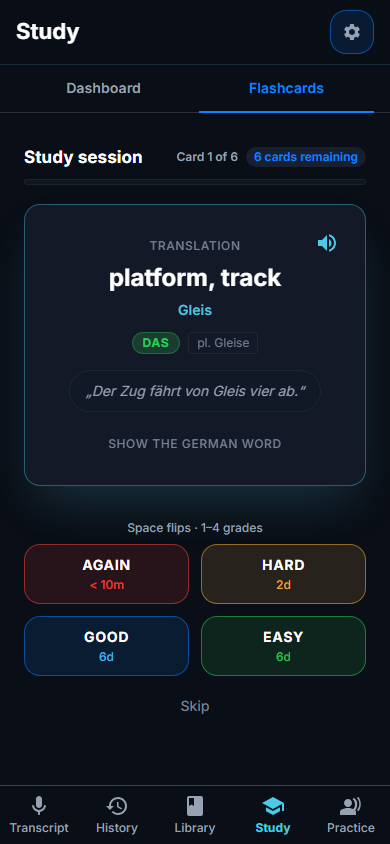 | **4. Flashcards.** Grades stay locked until the answer is showing, and each grade previews its next interval. Space flips the card and 1–4 grade it from the keyboard. |
| 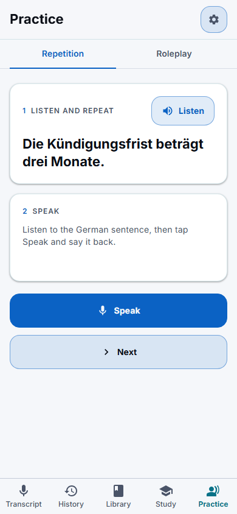 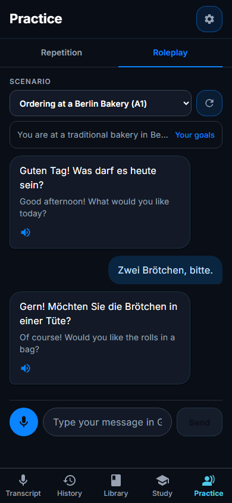 | **5. Practice.** Listen, then speak. The result counts the words the recogniser heard and says outright that this is recognition, not an accent score. Roleplay keeps the scenario and its goals in view, with a one-row voice-or-type composer. |
| 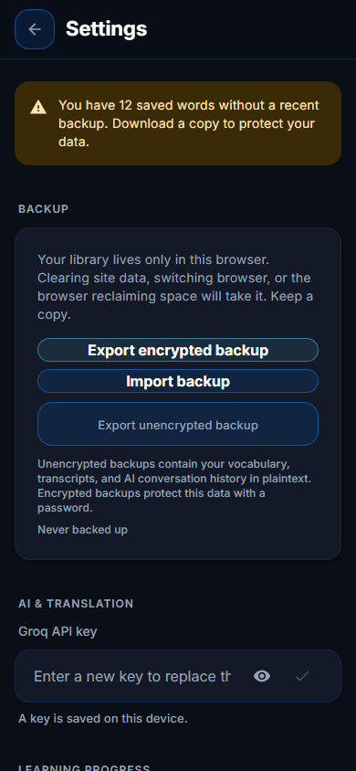 | **6. Settings.** Encrypted or plain backups, the API key, learner level, recognition dialect and storage durability, plus a confirmed reset. |

Android screenshots are in [`docs/screenshots/android/`](docs/screenshots/android/). They were retaken on 30 October 2026 on an API 36 emulator (1080×2400), from the same synthetic library the web screenshots use, after the Library, Study dashboard, Practice and roleplay changes above were carried over to Compose.

<p>
  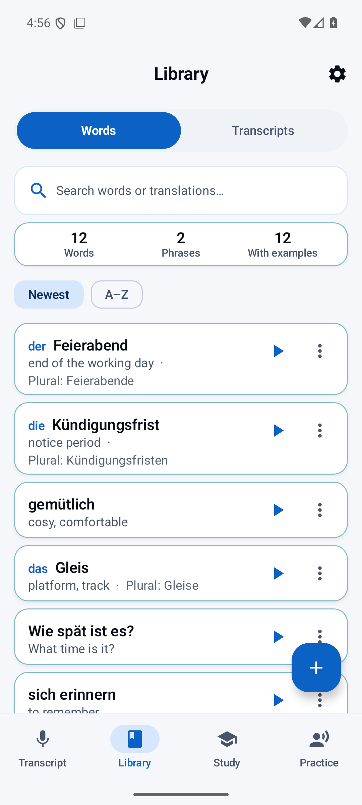
  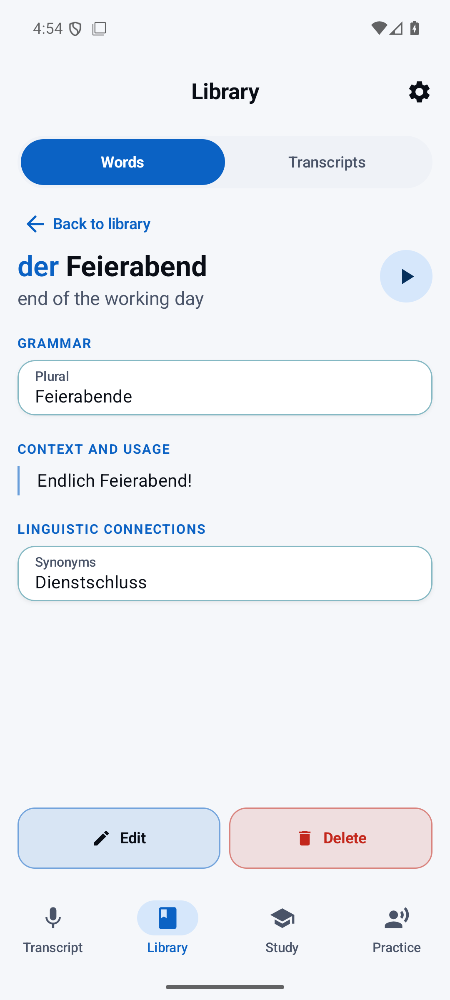
  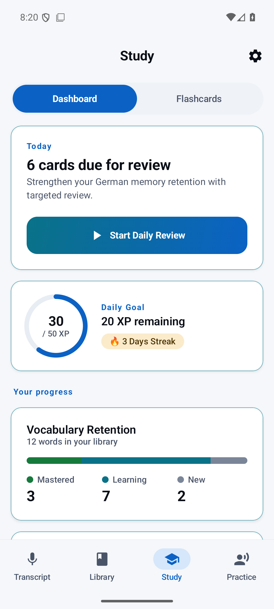
  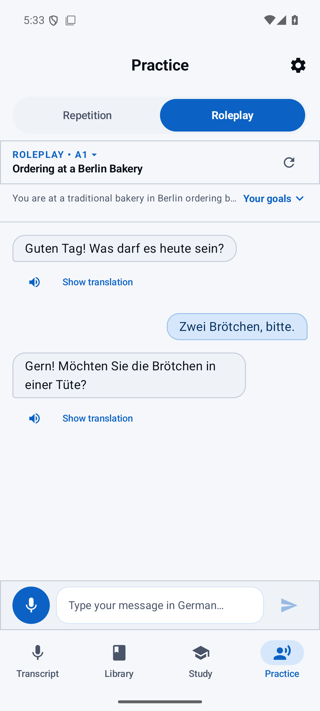
</p>

## Architecture

The two clients share **behaviour**, not code. Each is idiomatic on its platform. A JSON contract fixture that both test suites run keeps them agreeing on the things that must not drift.

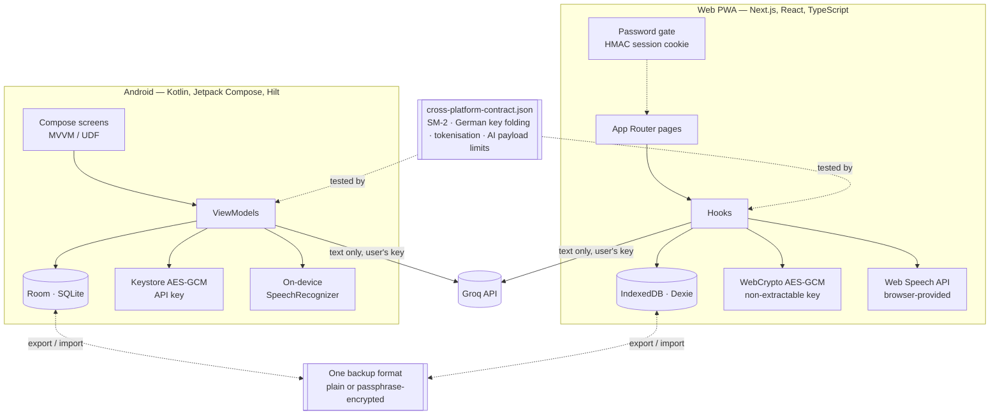

```text
app/                Android client (Kotlin, Compose, Room schema v18, minSdk 31)
web/                Web PWA (Next.js 16, React 19, Tailwind CSS 4, Dexie schema v9)
  tests/            Vitest unit and contract tests; Playwright e2e, axe and visual suites
  tests/portfolio/  On-demand screenshot capture with synthetic data
docs/               Case study, design system, security model, backup format, audits
tools/              Repository audit: string parity, palette parity, WCAG contrast
```

## Key decisions and trade-offs

- **Two native clients, not one cross-platform app.** On Android, on-device speech recognition, Keystore-backed encryption and a home-screen widget are first-class. An installable PWA reaches everyone else without an app store. The cost is two codebases, kept in step by a shared behavioural contract rather than shared code.
- **Local-first storage.** There are no accounts, no server database and no sync, so learning data cannot leak from a server that never holds it. Browser storage can be evicted, so both clients export and import one portable backup format (plain or passphrase-encrypted), and the web app asks the browser for persistent storage.
- **Bring-your-own AI key.** The key is encrypted at rest on the device and sent only to Groq. No proxy could ever see it.
- **Honest feedback.** Pronunciation practice reports how many words the speech recogniser heard, never a "pronunciation score": recognition returns a transcript, not phonetic data.
- **Grade only after reveal.** The scheduler never records a guess as recall.

The reasoning, including the problems that shaped it, is in the **[engineering case study](docs/portfolio-case-study.md)**. The visual rules are in [`docs/DESIGN_SYSTEM.md`](docs/DESIGN_SYSTEM.md).

## Privacy and security

| | Android | Web |
| :-- | :-- | :-- |
| Learning data | Room database on the device; excluded from OS cloud backup and device transfer | IndexedDB in the browser |
| Portability | Manual export/import, plain or passphrase-encrypted | Same format and the same choices |
| API key | AES-GCM under Android Keystore; never exported | AES-GCM with a non-extractable WebCrypto key; never exported |
| Speech recognition | Requests the on-device recogniser; with the German offline model installed, audio stays on the phone | Web Speech API, which the browser vendor's service implements (for example Google in Chrome, Apple in Safari); Settings says so |
| Sent to Groq | Text only: the sentence, word or roleplay turn | Same |
| Analytics and ads | None | None |
| Access | — | Password gate: HMAC session tokens, login rate limiting, revocable sessions |

The threat model and deployment checklist are in [`docs/SECURITY.md`](docs/SECURITY.md), and the backup envelope in [`docs/BACKUP_FORMAT.md`](docs/BACKUP_FORMAT.md).

## Verification

Every push runs [GitHub Actions](.github/workflows/build.yml):

- **Repository audit** (`python tools/audit_repo.py`): English/German string parity on both clients, Kotlin↔CSS palette parity, and WCAG contrast for every token pairing in both themes.
- **Android:** unit and contract tests, Android lint and a release build, plus instrumented tests on API 31 (full suite) and API 35 (platform smoke), including a Room migration walk.
- **Web:** ESLint with zero warnings, `tsc`, Vitest and a production build. Playwright covers functional flows, axe-core WCAG 2.1 AA scans of every route, navigation-structure checks at 360, 390, 768 and 1440 px, scroll-region regressions, and compatibility smoke tests in WebKit and Firefox. Pixel baselines in `docs/screenshots/web/` are a local design-review aid, because font rasterisation differs between machines.

## Getting started

**Prerequisites:** Node.js 22+, JDK 21, and Android Studio with SDK Platform 37. A free [Groq API key](https://console.groq.com/) enables translation, word details and roleplay; everything else works without one.

### Web

```bash
cd web
npm ci
cp .env.example .env.local   # then set SITE_PASSWORD and SESSION_SECRET
npm run dev                  # http://localhost:3000
```

Sign in with your `SITE_PASSWORD`, then add your Groq key under **Settings → AI & Translation**.

```bash
npm run lint && npm run typecheck && npm test   # static checks and unit tests
npm run test:e2e                                 # Playwright (builds first)
npm run screenshots                              # regenerate docs/screenshots/portfolio
```

**Deploying to Vercel:** set the project's Root Directory to `web` and configure the environment variables listed in [`docs/SECURITY.md`](docs/SECURITY.md).

> **About a public demo.** The hosted PWA is password-protected and stays that way. A separate public demo would be fairly low-risk, since each visitor's data lives in their own browser and the server holds no learner data or AI keys. But it means deploying and operating a second, ungated build, which is the owner's decision; this repository doesn't do it by default. The walkthrough above stands in for it.

### Android

```bash
./gradlew assembleDebug          # app/build/outputs/apk/debug/app-debug.apk
./gradlew testDebugUnitTest lintDebug
./gradlew connectedDebugAndroidTest   # on an API 31+ device or emulator
```

Add your Groq key under **Settings** in the app.

## Backup and data portability

Both clients export the whole library (vocabulary, transcripts, review history, XP, streak and the current roleplay) as plain JSON or as a passphrase-encrypted envelope. Each can import what the other wrote. The import is **validated before anything is written, then additive**: existing cards keep their schedules, matching words merge metadata without resetting progress, XP never decreases, and streaks are recomputed. API keys are never part of a backup. Details are in [`docs/BACKUP_FORMAT.md`](docs/BACKUP_FORMAT.md).

## Limitations and next steps

- Web speech recognition depends on the browser and is unavailable in Firefox; the app falls back to typing.
- Practice measures recognition, not pronunciation. A phoneme-level score would need a different engine.
- Nothing checks the two clients against each other visually yet; the screenshots are a review aid, not a gate.
- A public synthetic-data demo is possible (see above) but has not been set up.

## License

[MIT](LICENSE)
